# Module 6 - Service Discovery, Readiness & Recovery

For this lab I ran a small inventory app on a local Kubernetes cluster (I used **kind** on my Mac with Docker Desktop).
The setup is:

- `inventory` - a Deployment with 2 replicas of a tiny Python web app. The `/items` endpoint returns some inventory
  data plus the name of the Pod that answered, so I can tell the replicas apart.
- `inventory-service` - a ClusterIP Service in front of those 2 Pods.
- `inventory-client` - 1 Pod that calls `http://inventory-service:8080/items` every second and prints who answered.

The client only knows the Service name. There are no Pod IPs anywhere in its code or config.

## Architecture

```
  +--------------------+
  |  inventory-client  |   GET http://inventory-service:8080/items  (every 1s)
  +---------+----------+
            |
            |  DNS: inventory-service -> 10.96.217.83 (ClusterIP)
            v
  +-------------------------------+
  |  Service: inventory-service   |   selector: app=inventory
  |  ClusterIP 10.96.217.83:8080  |   only READY pods are added as endpoints
  +---------------+---------------+
                  |
         +--------+---------+
         v                  v
  +-------------+    +-------------+
  | inventory   |    | inventory   |   Deployment "inventory", replicas: 2
  | pod #1      |    | pod #2      |   readinessProbe: GET /ready every 2s
  +-------------+    +-------------+   livenessProbe:  GET /healthz
```

The app has three endpoints:

| Endpoint | What it does |
|---|---|
| `/items` | returns the inventory list and `served_by` (the Pod name) |
| `/ready` | used by the readiness probe. Returns 200, or 503 if the file `/tmp/not-ready` exists |
| `/healthz` | used by the liveness probe. Always 200 while the process is running |

So to make a Pod unready, I just create `/tmp/not-ready` inside it with `kubectl exec`. The process keeps running,
only the readiness check starts failing. Deleting the file makes it ready again.

## Files

```
app/            inventory app (inventory.py) + Dockerfile
client/         client (client.py) + Dockerfile
k8s/            inventory-deployment.yaml, inventory-service.yaml, client-deployment.yaml
scripts/demo.sh the commands I ran for every step below (saves output to docs/logs/)
docs/logs/      text output of every step
docs/screenshots/ terminal screenshots of every step
```

## How to run it

You need Docker Desktop running, `kubectl`, and [kind](https://kind.sigs.k8s.io/docs/user/quick-start/#installation)
(I used kind v0.27.0, Kubernetes v1.32.2).

```bash
# create the cluster
kind create cluster --name module6

# build both images and load them into the kind node (kind can't see local docker images otherwise)
docker build -t inventory-service:1.0 app
docker build -t inventory-client:1.0 client
kind load docker-image inventory-service:1.0 inventory-client:1.0 --name module6

# deploy
kubectl apply -f k8s/
kubectl get pods -o wide

# watch the client
kubectl logs -f deploy/inventory-client
```

To repeat my tests you can run each step of the script, e.g. `./scripts/demo.sh 07`, or all of them with
`./scripts/demo.sh all`. Steps 02 and 03 build, load and deploy, so with a fresh cluster `all` does everything.

The main commands for the tests are:

```bash
kubectl exec <pod> -- touch /tmp/not-ready   # make a pod fail readiness
kubectl exec <pod> -- rm /tmp/not-ready      # make it ready again
kubectl delete pod <pod>                     # kill a pod
kubectl get pods -l app=inventory -w         # watch the replacement come up
```

To clean up: `kind delete cluster --name module6`

---

## Part 1 - Deploying the app

Cluster is up (single node kind cluster):

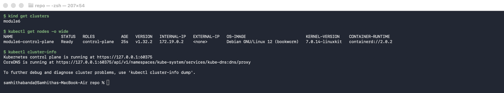

Built both images and loaded them into the kind node:

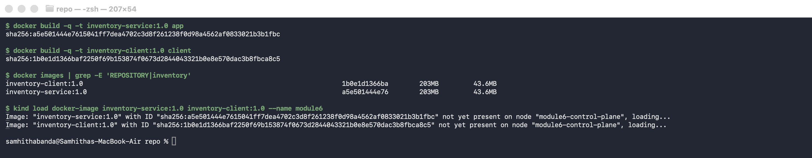

Applied the YAML files. Both inventory Pods (`lczrv` and `wdvdf`) and the client are `1/1 Running`:

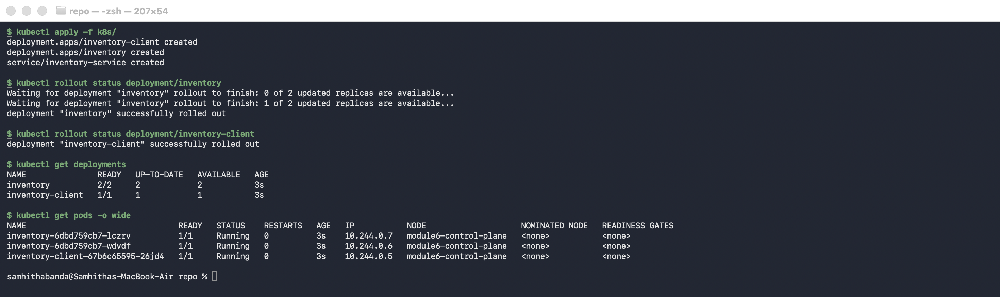

The Service got the ClusterIP `10.96.217.83` and it has both Pod IPs as endpoints (`10.244.0.6` and `10.244.0.7`):

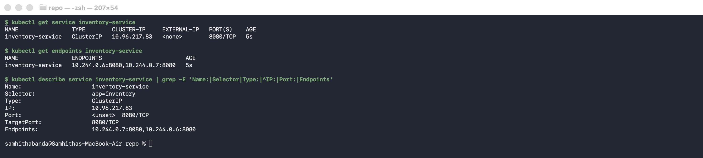

### Client uses the Service name

The URL in the client code and in the client Deployment is `http://inventory-service:8080/items`. Inside the client
Pod, the name `inventory-service` resolves to the Service ClusterIP (not to a Pod), and a request through it works:

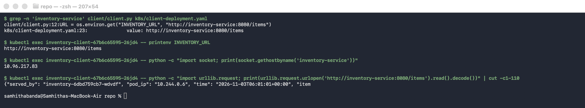

### Requests reach both replicas

After letting the client run for 30 seconds, its requests were split between the two Pods. It was 15 and 15 this time,
but it changes every run because kube-proxy picks a Pod at random for each new connection. Each Pod's own log also
shows the requests coming from the client Pod's IP (`10.244.0.5`).

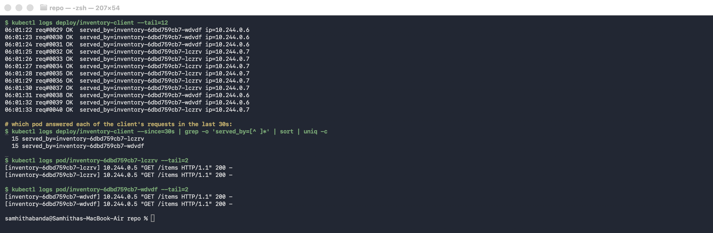

```
$ kubectl logs deploy/inventory-client --since=30s | grep -o 'served_by=[^ ]*' | sort | uniq -c
  15 served_by=inventory-6dbd759cb7-lczrv
  15 served_by=inventory-6dbd759cb7-wdvdf
```

## Part 2 - Readiness test

I made `inventory-6dbd759cb7-lczrv` fail its readiness probe. A few seconds later it shows `0/1` but the STATUS is
still `Running`, and the Service endpoints dropped down to only `10.244.0.6` (the other Pod):

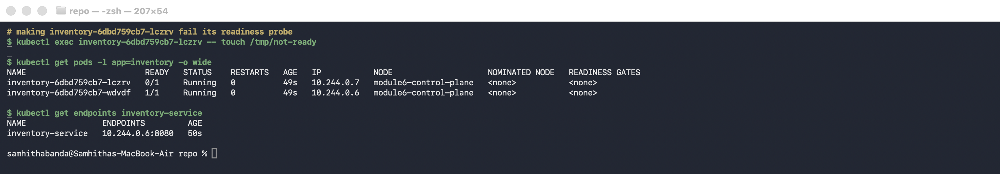

`kubectl describe` shows why. The readiness probe is getting a 503:

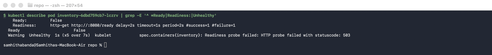

Then I checked where the traffic was going. All 12 client requests in the next 12 seconds went to `wdvdf`.
I also checked the unready Pod's own log, and it received 0 requests in that time, so it really was taken out of
rotation:

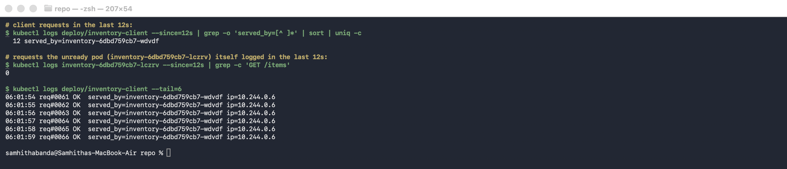

```
  12 served_by=inventory-6dbd759cb7-wdvdf
$ kubectl logs inventory-6dbd759cb7-lczrv --since=12s | grep -c 'GET /items'
0
```

The unready Pod is still alive. It is `Running` with 0 restarts, `/healthz` still answers, and only `/ready` returns 503.
Kubernetes didn't kill it because the liveness probe is fine. It just stopped sending it traffic.

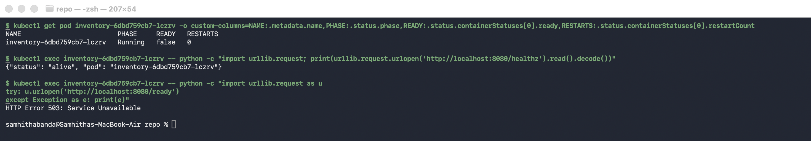

### Restoring readiness

I removed the file. The Pod went back to `1/1` and its IP came back into the endpoints:

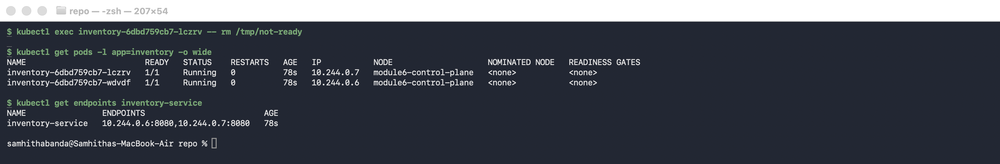

Within about 2 seconds it was getting client requests again (first one was `req#0075`), and the next 20 requests were
split 10 / 10:

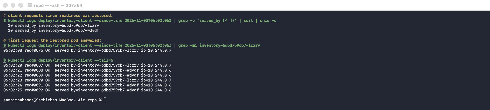

## Part 3 - Pod failure and recovery

Before deleting anything: 2 Pods, Service ClusterIP `10.96.217.83`, 2 endpoints.

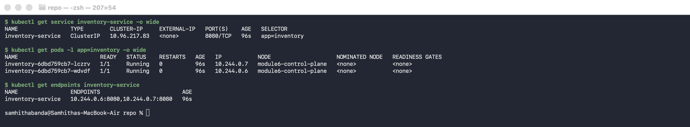

I deleted `inventory-6dbd759cb7-lczrv` and watched the Pods. The ReplicaSet created a new Pod right away
(`tlq4g`, `ContainerCreating` at age 0s), and it was `1/1 Running` about 2 seconds later. The old one went
`Terminating` then `Completed`.

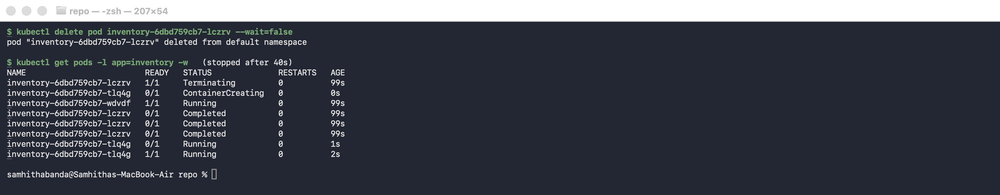

After the replacement, the Deployment is back to `2/2`. The new Pod has a different name and a different IP, but the
Service name and ClusterIP did not change. The endpoints just updated to the new IP on their own. The events show
`Killing` for the old Pod and `SuccessfulCreate` for the new one.

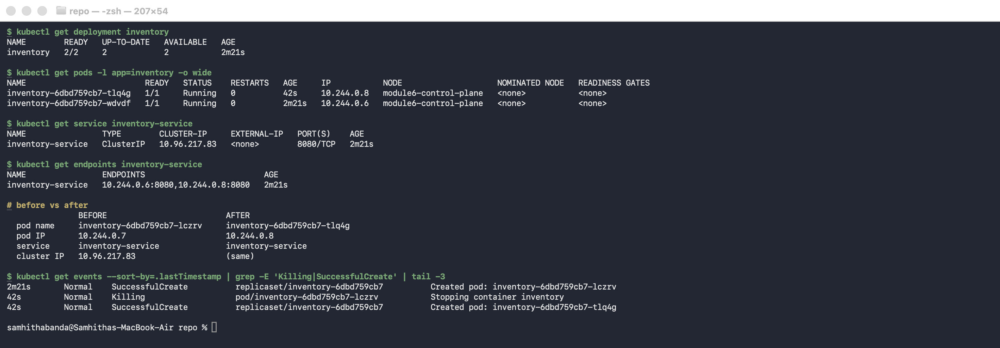

| | Before | After |
|---|---|---|
| Pod name | `inventory-6dbd759cb7-lczrv` | `inventory-6dbd759cb7-tlq4g` |
| Pod IP | `10.244.0.7` | `10.244.0.8` |
| Service name | `inventory-service` | `inventory-service` |
| Service ClusterIP | `10.96.217.83` | `10.96.217.83` |
| Endpoints | `10.244.0.6, 10.244.0.7` | `10.244.0.6, 10.244.0.8` |

The client kept going the whole time with the same URL. From the moment I deleted the Pod there were 0 failed requests,
and the new Pod got its first request at `req#0106`, about 7 seconds after the delete:

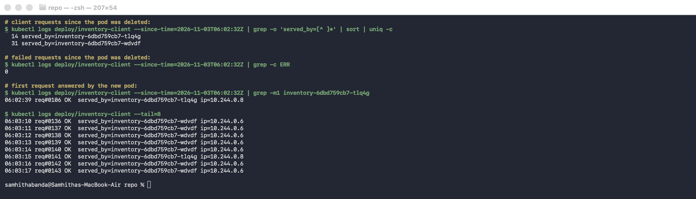

```
# client requests since the pod was deleted:
  14 served_by=inventory-6dbd759cb7-tlq4g
  31 served_by=inventory-6dbd759cb7-wdvdf
# failed requests since the pod was deleted:
0
```

All the raw output is in [`docs/logs/`](docs/logs) (one file per screenshot).

## Some things I ran into

- The images only exist locally, so with kind they have to be loaded with `kind load` and the YAML uses
  `imagePullPolicy: IfNotPresent`. Without that, Kubernetes would try to pull them from Docker Hub and fail.
- At first, deleting a Pod left it in `Terminating` for 30 seconds and it ended up as `Error`. That's because Python
  running as PID 1 ignores SIGTERM, so Kubernetes had to wait for the grace period and then SIGKILL it. I added a small
  SIGTERM handler in `inventory.py` and now it stops right away and shows `Completed`.
- I set the readiness probe to `periodSeconds: 2` and `failureThreshold: 1` so the change shows up fast for the demo.
  In a real app I would make it less sensitive so one slow response doesn't pull a Pod out.

## Reflection

Why is a stable Service name useful when Pods can fail or be replaced?

Pods are not permanent. In this lab the Pod I deleted came back as a completely different Pod with a new name and
IP (`lczrv` at `10.244.0.7` became `tlq4g` at `10.244.0.8`). If the client had been pointing at a Pod IP, it would
have broken as soon as that happened. Because it uses `inventory-service`, which always resolves to the same ClusterIP,
the client never needed to change. Kubernetes keeps the list of ready Pods behind that name up to date by itself, which
is also why the unready Pod stopped getting traffic without me doing anything on the client side.
