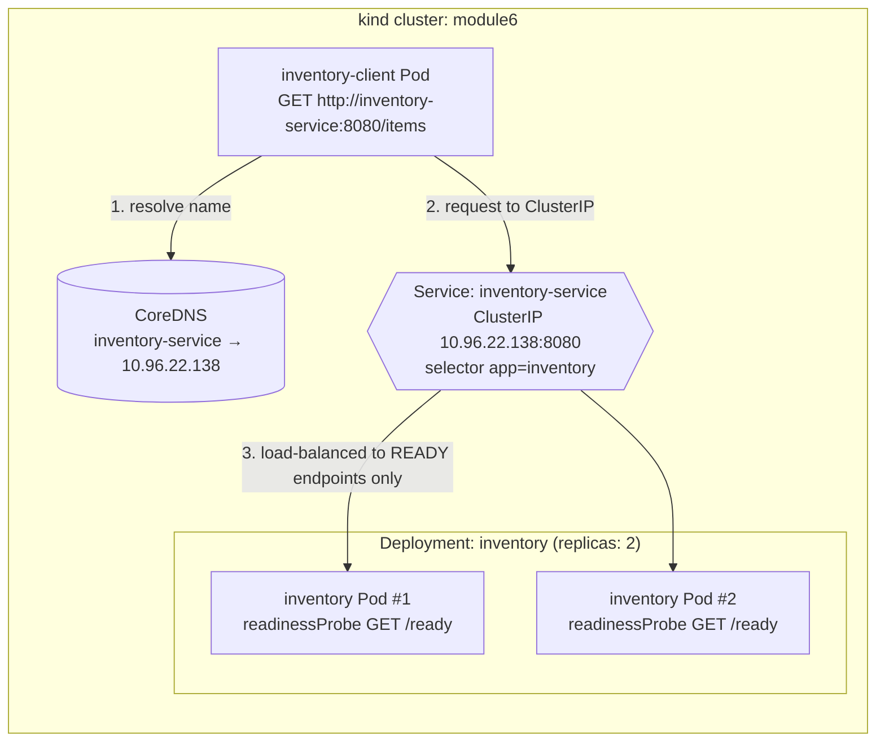
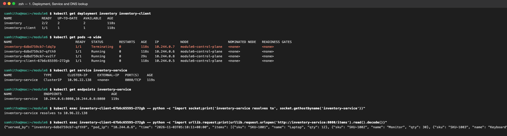
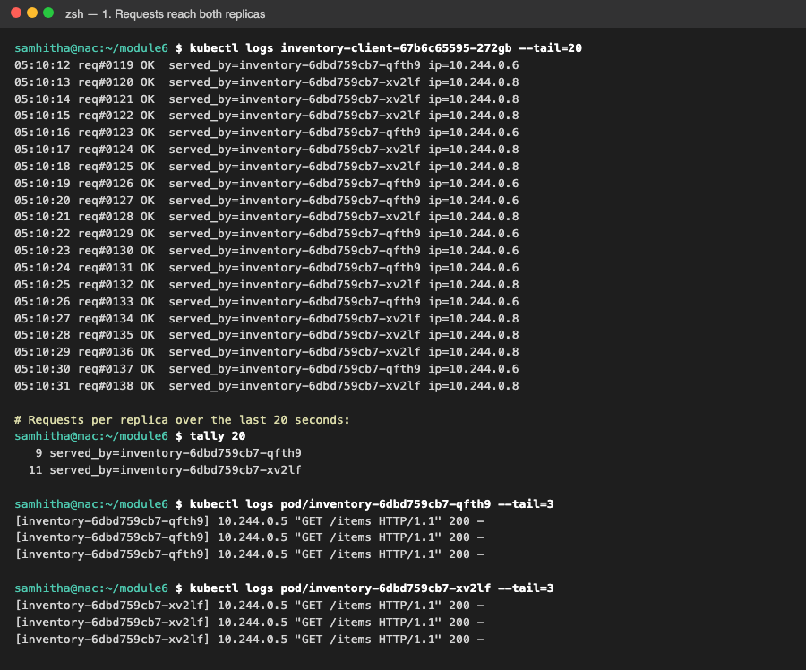
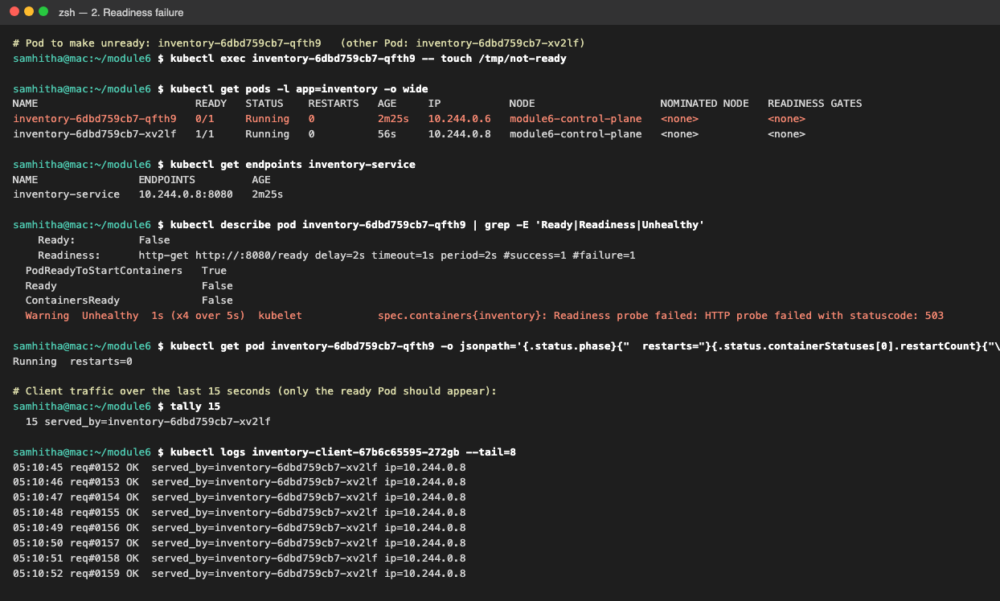
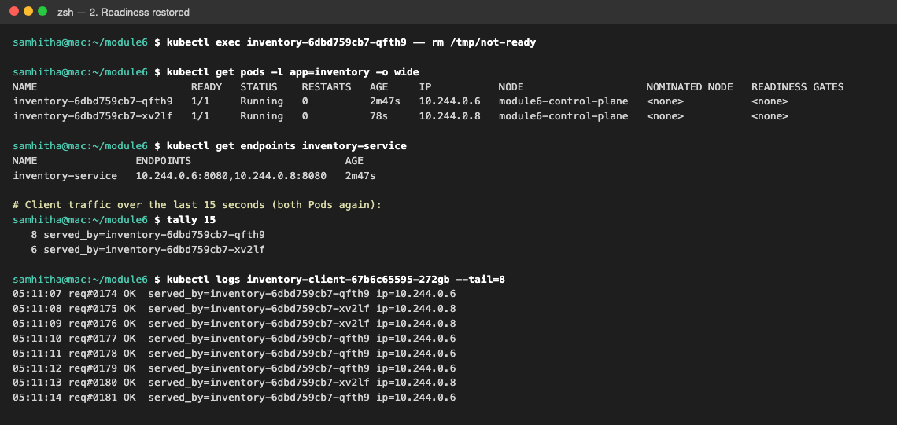
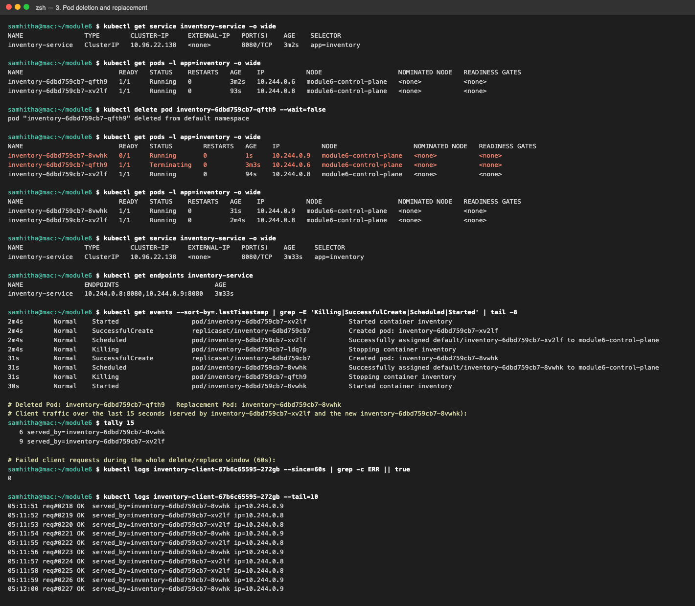

# Module 6: Service Discovery, Readiness & Recovery

I deployed a small **Inventory Service** to a local Kubernetes cluster (**kind**) to show three things:
how service discovery works through a Service name, how a readiness probe takes a Pod out of rotation,
and how Kubernetes replaces a deleted Pod.

| Component | Kind | Replicas | Purpose |
|---|---|---|---|
| `inventory` | Deployment | 2 | Python HTTP API (`/items`, `/ready`, `/healthz`). Every response says which Pod served it. |
| `inventory-service` | Service (ClusterIP) | – | Stable name and virtual IP in front of all **ready** `app=inventory` Pods |
| `inventory-client` | Deployment | 1 | Calls `http://inventory-service:8080/items` once a second and logs who answered |

The client only knows the Service name. It never uses a Pod IP.

## Repository layout

```
app/inventory.py               Inventory Service (Python standard library only)
app/Dockerfile
client/client.py               Client that calls the Service by name
client/Dockerfile
k8s/inventory-deployment.yaml  2 replicas + readiness and liveness probes
k8s/inventory-service.yaml     ClusterIP Service "inventory-service"
k8s/client-deployment.yaml     1 client Pod
scripts/demo.sh                Runs all 3 experiments and saves output to docs/logs/
scripts/render_screenshots.py  Turns docs/logs/*.txt into PNG screenshots
docs/logs/                     Raw terminal output (evidence)
docs/screenshots/              Screenshots (evidence)
```

## Architecture



Plain-text version:

```
                        +--------------------------------------+
 inventory-client  ---> |  Service: inventory-service          |
 (calls by DNS name)    |  ClusterIP 10.96.22.138:8080         |
                        |  endpoints = READY Pods only         |
                        +------------------+-------------------+
                                           |
                         +-----------------+-----------------+
                         v                                   v
               inventory Pod A (ready?)            inventory Pod B (ready?)
               GET /ready -> 200 / 503             GET /ready -> 200 / 503
                         \___ Deployment "inventory", replicas: 2 ___/
```

**How readiness is controlled:** `/ready` returns `200` normally and `503` while the file `/tmp/not-ready`
exists in the container. Running `kubectl exec <pod> -- touch /tmp/not-ready` makes that one Pod fail its readiness
probe without stopping the process, and `rm /tmp/not-ready` restores it. The probe runs every 2 seconds
with `failureThreshold: 1`, so the change shows up quickly.

## How to deploy

Prerequisites: Docker Desktop (running), `kubectl`, and [`kind`](https://kind.sigs.k8s.io/) (v0.27.0 used here).
minikube or Docker Desktop Kubernetes also work; just load the images into that cluster instead.

```bash
# 1. Create a cluster
kind create cluster --name module6

# 2. Build the images and load them into the kind node
docker build -t inventory-service:1.0 app
docker build -t inventory-client:1.0 client
kind load docker-image inventory-service:1.0 inventory-client:1.0 --name module6

# 3. Deploy everything
kubectl apply -f k8s/
kubectl rollout status deployment/inventory
kubectl rollout status deployment/inventory-client

# 4. Watch the client
kubectl logs -f deployment/inventory-client
```

Run all three experiments and regenerate the evidence:

```bash
./scripts/demo.sh                       # writes docs/logs/*.txt
python3 scripts/render_screenshots.py   # writes docs/screenshots/*.png (needs Google Chrome)
```

Manual commands for each experiment:

```bash
POD=$(kubectl get pods -l app=inventory -o jsonpath='{.items[0].metadata.name}')
kubectl exec $POD -- touch /tmp/not-ready     # make one Pod unready
kubectl get pods -l app=inventory; kubectl get endpoints inventory-service
kubectl exec $POD -- rm /tmp/not-ready        # restore readiness
kubectl delete pod $POD                       # delete a Pod
kubectl get pods -l app=inventory -w          # watch the replacement appear
```

Clean up: `kind delete cluster --name module6`

---

## Results and evidence

All of the output below comes from one run of `scripts/demo.sh` against the cluster. The raw text is in
[`docs/logs/`](docs/logs), and the screenshots in [`docs/screenshots/`](docs/screenshots) are made from that same output.

### 1. Deploy the application

**Both Pods are running, and the Service has both of them as endpoints.** The client resolves
`inventory-service` through cluster DNS to the Service ClusterIP `10.96.22.138`, not to a Pod IP.



```
$ kubectl get endpoints inventory-service
NAME                ENDPOINTS                         AGE
inventory-service   10.244.0.6:8080,10.244.0.8:8080   119s

$ kubectl exec inventory-client-... -- python -c "...socket.gethostbyname('inventory-service')"
inventory-service resolves to 10.96.22.138
```

**Requests reach more than one replica.** Over 20 seconds, the client's 20 requests to the *same* Service name
were split between the two Pods. Each Pod's own log also shows requests coming from the client Pod (`10.244.0.5`).



```
# Requests per replica over the last 20 seconds:
   9 served_by=inventory-6dbd759cb7-qfth9
  11 served_by=inventory-6dbd759cb7-xv2lf
```

### 2. Readiness test

**Failure.** I touched `/tmp/not-ready` in `inventory-6dbd759cb7-qfth9`. Then:

- The Pod is **still `Running` with 0 restarts**, but `READY` is `0/1`. The kubelet reports
  `Readiness probe failed: HTTP probe failed with statuscode: 503`.
- The Service endpoints dropped from 2 IPs to just `10.244.0.8:8080` (the ready Pod).
- **All 15 of the client's requests** in the next 15 seconds were served by the other Pod (`xv2lf`), with no errors.



```
NAME                         READY   STATUS    RESTARTS   AGE
inventory-6dbd759cb7-qfth9   0/1     Running   0          2m25s
inventory-6dbd759cb7-xv2lf   1/1     Running   0          56s

inventory-service   10.244.0.8:8080

# Client traffic over the last 15 seconds (only the ready Pod should appear):
  15 served_by=inventory-6dbd759cb7-xv2lf
```

**Recovery.** After `rm /tmp/not-ready`, the Pod went back to `1/1`, its IP came back into the endpoints,
and it started receiving client traffic again.



```
inventory-service   10.244.0.6:8080,10.244.0.8:8080

# Client traffic over the last 15 seconds (both Pods again):
   8 served_by=inventory-6dbd759cb7-qfth9
   6 served_by=inventory-6dbd759cb7-xv2lf
```

### 3. Pod failure and recovery

I deleted `inventory-6dbd759cb7-qfth9`. Then:

- The ReplicaSet **immediately created a replacement**, `inventory-6dbd759cb7-8vwhk`. It has a **new name and a new IP**
  (`10.244.0.9` instead of `10.244.0.6`). The events show `Killing` for the old Pod and `SuccessfulCreate` for the new one.
- The **Service stayed exactly the same**: same name `inventory-service`, same ClusterIP `10.96.22.138`.
  Only its endpoint list changed, to `10.244.0.8, 10.244.0.9`.
- The client kept using the same URL the whole time. **0 failed requests** in the 60-second delete/replace window,
  and traffic is now split between the surviving Pod and the new one.



```
$ kubectl delete pod inventory-6dbd759cb7-qfth9 --wait=false
NAME                         READY   STATUS        RESTARTS   AGE
inventory-6dbd759cb7-8vwhk   0/1     Running       0          1s     <- replacement, new name
inventory-6dbd759cb7-qfth9   1/1     Terminating   0          3m3s   <- deleted Pod
inventory-6dbd759cb7-xv2lf   1/1     Running       0          94s

inventory-service   ClusterIP   10.96.22.138   8080/TCP   (before and after: unchanged)
inventory-service   10.244.0.8:8080,10.244.0.9:8080

# Deleted Pod: inventory-6dbd759cb7-qfth9   Replacement Pod: inventory-6dbd759cb7-8vwhk
   6 served_by=inventory-6dbd759cb7-8vwhk
   9 served_by=inventory-6dbd759cb7-xv2lf
# Failed client requests during the whole delete/replace window (60s):
0
```

Note: `xv2lf` was itself a replacement, made when an earlier run of the script deleted Pod `ldq7p`. You can see its
`Killing` / `SuccessfulCreate` events in the same screenshot. So every Pod name changed during the lab, and the
client's configuration never had to change.

---

## Reflection

Pods are temporary: a Pod can crash, fail its readiness check, or be deleted, and the replacement comes back
with a new name and a new IP, as `qfth9` (10.244.0.6) was replaced by `8vwhk` (10.244.0.9) in this lab.
If the client had been configured with Pod IPs, every replacement would have broken it, or someone would have had to
update it by hand. The Service gives clients one stable DNS name and ClusterIP (`inventory-service` / `10.96.22.138`).
Kubernetes keeps the list of healthy, ready Pods behind it up to date automatically, so clients do not need to know
which Pods exist at any moment. Readiness probes plus a stable Service name are what let the client keep working with
zero failed requests while Pods were going unready, being deleted, and being replaced.
